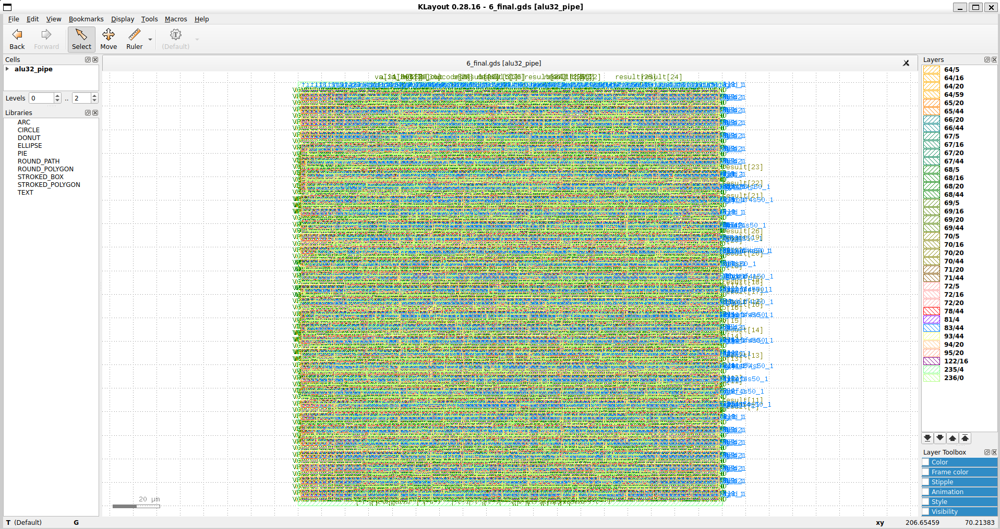

# 32-bit Pipelined ALU — RTL-to-GDSII

A 32-bit pipelined Arithmetic Logic Unit designed in Verilog and implemented using the open-source RTL-to-GDSII flow with Yosys, OpenROAD, and the Sky130 HD platform.

## Features

- 32-bit arithmetic and logic operations
- Addition, subtraction, AND, OR, XOR
- Left and right shifts
- Signed less-than comparison
- Clocked operation with reset and valid signals

## Tools

- Verilog
- Icarus Verilog and VVP
- Yosys
- OpenROAD-flow-scripts
- OpenROAD
- SkyWater SKY130 HD
- KLayout

## Implementation Flow

RTL design → Functional simulation → Logic synthesis → Floorplanning → Placement → Clock-tree synthesis → Routing → Timing analysis → GDSII generation.

## Verification

The functional testbench passed its included test cases. The configured physical-design flow reported matching LVS netlists and zero DRC violations.

These results apply to the checks configured in this educational project and do not constitute foundry signoff.

## Repository Structure

- `rtl/`: Verilog RTL
- `tb/`: Functional testbench
- `flow/`: OpenROAD configuration and timing constraints
- `reports/`: Selected implementation reports
- `images/`: Physical layout screenshots

## Disclaimer

Educational ASIC implementation project. No fabricated silicon is claimed.

## Final Physical Layout

